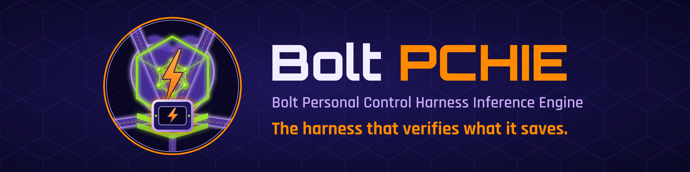

<p align="center">
  
</p>

# Bolt PCHIE

**Bolt Personal Control Harness Inference Engine** (pronounced "bolt peachy").

An open-source robotics test bed for on-device inference, built around NVIDIA Nemotron models. PCHIE runs a small language model inside a deterministic control harness and asks it to act in a simulated world (LithoKraft mazes), with every decision sealed into a hash chain so a run can be replayed and checked.

## Get started

Build from source and run the quick tests:

- [Quick start: running the maze](docs/guide/quick-start-maze.md) from a release download
- [Playing LithoKraft](docs/guide/playing-lithokraft.md), the game build that ships with the release
- [Getting started on Windows](docs/guide/getting-started-windows.md)
- [Getting started on Linux](docs/guide/getting-started-linux.md)

Prebuilt binaries are published on the GitHub Releases page, each release with a `SHA256SUMS` file. [Checksums](docs/guide/checksums.md) explains how to verify a download.

## Models and modalities

| Name | Model | Modality | Role |
|---|---|---|---|
| **Little Nemo** | NVIDIA Nemotron 3.5 Bolt E4B (`Nemotron-3.5-Bolt-E4B-Q4_K_M.gguf`, gemma4 architecture) | Text in, text out | The reasoning model inside the harness. It proposes every action on the decide path. |
| **Vision path** (visnav) | Little Nemo, same weights | Rendered game frames, encoded to text | Vision-only navigation: the model reads live LithoKraft frames as text and never reads the world map. There is no separate image encoder in this tree. |
| **Elfie** | Muse Wonder | Text | Research partner and transparency-anchoring witness. Outside the harness; receives only signed tree heads and consistency proofs. |
| **Archie** | Google Argon | Text | Systems architecture and search counsel. Outside the harness. |

Model weights are not in the repository.

## Safety-first framing

- **Deterministic by construction.** Same weights, same inputs, same seed give the same decisions and the same hashes, at any thread count. A moved hash is treated as a finding and is stopped and explained, never smoothed over.
- **The harness decides what the model may touch.** Gates, crutch audits and label rules sit between the model and the world. Side logs observe a run and never feed it.
- **Two validations.** A run is *chain-valid* when a machine re-derives its hash chain. It is *truth-valid* only when a person has checked what it claims. Tooling never upgrades a label.
- **Receipts.** Transparency anchoring (below) seals chain heads into a signed, witnessed append-only log, so history cannot be quietly rewritten.

## Record labels

| Label | Meaning |
|---|---|
| **Official** | Frozen record produced by the official runners and accepted by the human truth seat. |
| **Provisional** | Candidate result, reproducible, not yet accepted. Hashes may still change. |
| **Scratch** | Exploratory work. Useful evidence, never a claim. |

Labels only move up by a person's decision. Everything added in November 2026 is Scratch or Provisional; hashes quoted in the reports are provisional and not locked.

## Documentation

A researcher-facing guide lives under [`docs/guide/`](docs/guide/README.md). It is written from the code, tests, and notes in this tree. Hashes quoted there are provisional unless they belong to a frozen Official record. The harness is described as tamper-evident, never tamper proof.

- [Quick start: running the maze](docs/guide/quick-start-maze.md)
- [Playing LithoKraft](docs/guide/playing-lithokraft.md)
- [Getting started on Windows](docs/guide/getting-started-windows.md)
- [Getting started on Linux](docs/guide/getting-started-linux.md)
- [Checksums](docs/guide/checksums.md)
- [Overview](docs/guide/overview.md)
- [Architecture](docs/guide/architecture.md)
- [Diagrams](docs/guide/diagrams.md)
- [Determinism and hashing](docs/guide/determinism-and-hashing.md)
- [Seal chains](docs/guide/seal-chains.md)
- [Transparency anchoring](docs/guide/transparency-anchoring.md)
- [TESLA stream authentication](docs/guide/tesla-stream-authentication.md)
- [Hardware attestation](docs/guide/hardware-attestation.md)
- [Reasoning layers and the loop guard](docs/guide/reasoning-layers.md)
- [LithoKraft and LithoLattice](docs/guide/lithokraft-integration.md)
- [LithoKraft component reference](docs/components/README.md) — the 12 November 2026 playtest build, signal rules, and one spec sheet per component, with image slots for CloudAtlas artwork
- [Build and test](docs/guide/build-and-test.md)
- [Results so far](docs/guide/results.md)
- [Limitations and threat model](docs/guide/limitations-and-threat-model.md)
- [Glossary](docs/guide/glossary.md)

## Repository map

| Path | What it holds |
|---|---|
| `include/`, `src/` | The core harness and inference engine: GGUF loading, deterministic CPU/CUDA kernels, KV pools, MCTS/PUCT search, PCH stack, maze fixtures (B1, Stage B), hash chains. Reasoning-layer headers are `include/pchie/rl/`, sources `src/rl/`. |
| `tests/` | Gate and regression tests for the core (step gates, maze suites, contract tests). Reasoning-layer tests are `tests/rl/`. |
| `reasoning/` | Scratch data and scripts for the reasoning layers (label stubs, hash-move notes). The layer itself builds with the root CMake. |
| `vision/` | One vision-only navigation (visnav) driver, labeled Scratch. Way-shut, reach, and NEML are runtime flags, default off. Seeded mazes keep seed 1 and size 16. The CUDA decide path is a separate compile. |
| `anchoring/` | Transparency anchoring: RFC 9162-style Merkle log, signed tree heads, witness cosigning, fingerprints, verifier. |
| `experiments/` | Launchers for the planner comparison, query-before-plan, and Stage B runs, and the lab environment variables. |
| `tools/` | Small utilities (maze preview, LithoKraft pilot, search gate). |
| `docs/` | Researcher guide (`docs/guide/`), LithoKraft component reference (`docs/components/`), plans and specs (`docs/specs/`), working notes (`docs/notes/`), and measurement reports (`docs/reports/`). |
| `third_party/` | Vendored dependencies, including the public PCH engine. |

## Build

Windows and Linux build steps, the quick test set, and a first harness run are in the getting-started pages above. The short form on Windows, with Visual Studio 2022 Build Tools or later, CMake 3.24 or newer, and optional CUDA 12, is:

```
cmake -S . -B build -G "Visual Studio 17 2022" -A x64
cmake --build build --config Release -j %NUMBER_OF_PROCESSORS%
```

On Linux, configure a single Release tree with `cmake -S . -B build -DCMAKE_BUILD_TYPE=Release` and build with `cmake --build build -j`. Sub-projects can also be built on their own: `anchoring/` and `vision/`. The reasoning layer is part of the root build. Model weights are not in the repository.

## Verify

- Run the quick tests described in the getting-started pages, and compare reported Official pins with [Results so far](docs/guide/results.md).
- Check downloaded release files against that release's `SHA256SUMS`, as described in [Checksums](docs/guide/checksums.md).
- Check an anchored run: `pchie_anchor verify <log> --anchor-index i --chain-file <side log> --fingerprint "<digits>"` prints PASS/FAIL per check (inclusion, consistency, fingerprint, chain re-derivation).

## Credits

- Art and brand by **CloudAtlas**
- Built by **Cortana**, with **SpaceXAI** and **Grok Bot**
- Transparency anchoring co-discovery, research, and witness role: **Elfie** (Muse Wonder)
- Systems architecture and search counsel: **Archie** (Google Argon)
- Architecture and direction by **Jaydee Wetwork**, **Wet Wafer Works**
- Clean-room design inspired by vLLM, SGLang and llama.cpp; stepping math after DeepSeek

## License

[MIT](LICENSE) © 2026 Jaydee Wetwork / Wet Wafer Works
