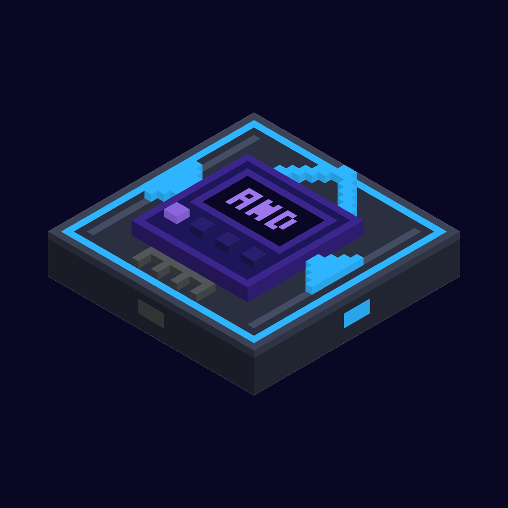

# Bitor

**Engine id:** `lithokraft:bitor`  
**Spelling:** Bitor (never Biter or BitOr).  
**Kind:** Full block, two-operand bitwise unit.

*CloudAtlas. State shown: Bitor B, AND, blue, on.*

## What it does

Faces, relative to the block:

| Face | Role |
|---|---|
| West and east | The two operands (commutative) |
| Back | Control strength, which selects the op |
| Front | Output |

Strengths 0 through 64 are treated as bit patterns over the seven places 1, 2, 4, 8, 16, 32, and 64. The control strength selects the op by range (locked):

| Control | Op |
|---|---|
| 0-15 | AND (control 0, the default, is AND) |
| 16-31 | OR |
| 32-47 | XOR |
| 48-64 | NOR (this last range is one wider, because 0 through 64 is 65 values) |

An over-range result emits 64 (saturate), never 0, and has no special look. The output recomputes two ticks after a new value arrives on the west, east, or back face. A change while a recompute is pending restarts those two ticks from the most recent change (a change at T and at T+1 updates at T+3). That restart rule is the interpretation used since an earlier playtest build and is not separately sealed. The armed-op still and lamps follow the op in force on the same two-tick cadence as the output.

State value is the published output. Aux bit 0 is "control greater than 0 now" (back tint). Aux bits 1-2 record the op in force (0 AND, 1 OR, 2 XOR, 3 NOR).

## Open and unimplemented

An earlier, unconfirmed read-back proposed exact control values 16 = OR, 32 = XOR, and 64 = NOR, and left any other non-zero control unarmed. That mapping was not sealed and is not what this build does. The range table above is the locked rule, and AND, OR, XOR, and NOR over those seven bit places are implemented.

Operand-face tint (east and west) was noted as unspecified in earlier landing notes; the approved still used here is the AND, blue, on hero.
