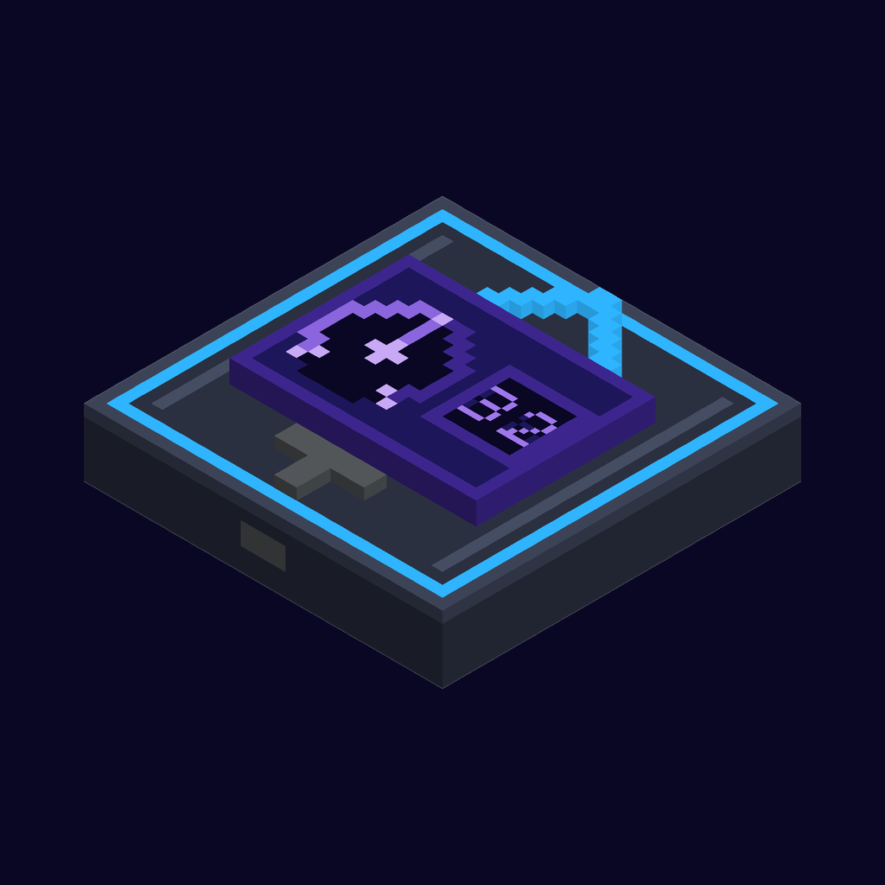

# Dialor

**Engine id:** `lithokraft:dialor`  
**Spelling:** Dialor (never Dialer).  
**Kind:** Full block, independent signal source. It is a reserved Trace keyword.

*CloudAtlas. State shown: dial at 32, on, blue tint. The back is unpowered, so the front outputs 32.*

## What it does

The Dialor is a 65-position source. The top dial selects 0 through 64; 0 is no signal. A newly placed Dialor (state value 0) selects 0. That 0 position was added after an earlier 1-through-64 range.

The output is the dial value, not an incoming signal. When the block faces north, output is on the north face (front). Faces rotate with facing. Only the back inhibits: if the back is powered, the output is 0; otherwise the output is the dial. East and west are inert.

Delay is one tick.

## Setting the dial

The dial is set with Alt and the scroll wheel (`kCmdAltUse`), not with a bare right-click. While Alt is held, the wheel does not change the hotbar. Wheel up steps +1; wheel down steps -1, implemented as a wrapping step. The value wraps 0 to 64 and 64 to 0.

In the behaviour itself, `use()` is +1 and `useAlt()` is -1, with the same wrap. A bare right-click is not routed to the Dialor: `playerUsable` excludes it, so a click does not cycle the dial even though `use()` exists on the class.

## Open and unimplemented

The 0-through-64 range and the Alt-wheel control are implemented. There is no additional Dialor mode in this build.
