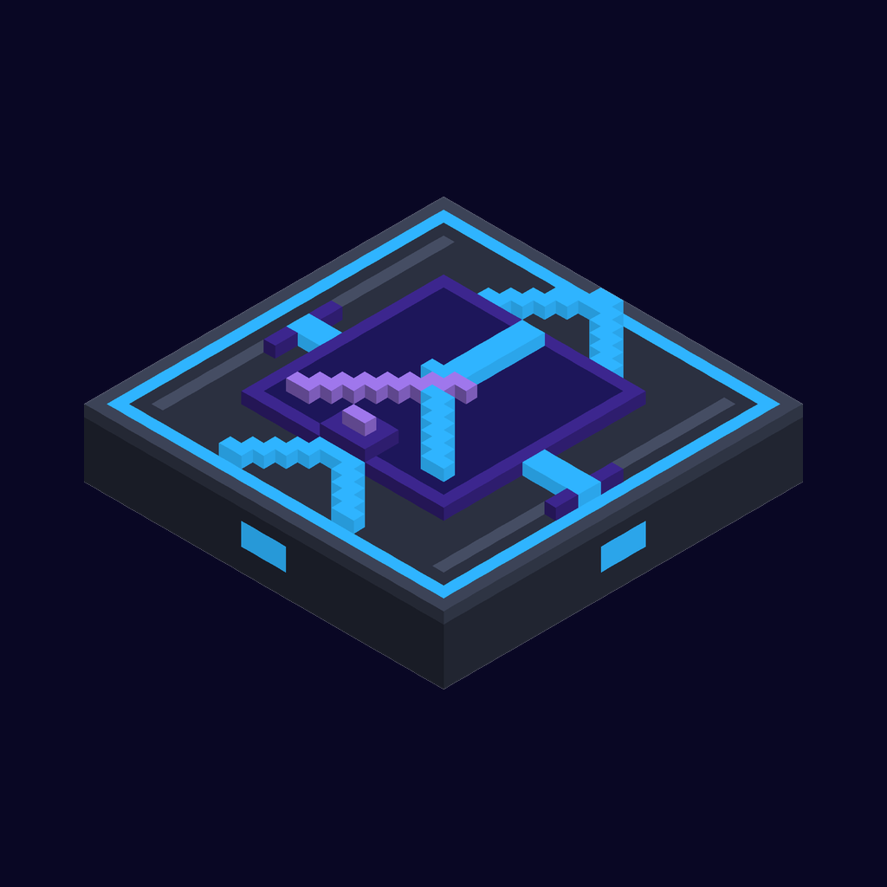

# Multiplexor

**Engine id:** `lithokraft:multiplexor`  
**Spelling:** Multiplexor (with an o; never Multiplexer in the registry). The artwork file is named `multiplexer.png`.  
**Kind:** Full block, signal component.

*CloudAtlas. State shown: lane select red, blue tint, powered on. This is the approved select-red still, framed for this reference.*

## What it does

The Multiplexor is a colourless 2:1 mux in its default, unsplit mode. Its output drives red and blue Trace alike, so it can transfer a signal from one colour to the other.

Facing is relative to the block. In the north-facing reference:

| Face | Role |
|---|---|
| North (front) | Output |
| South (back) | Input A |
| East (right) | Input B |
| West (left) | Control |
| Top and front | Ignored as inputs |

Control strength 0 selects A. Any strength greater than 0 on the control face selects B. Delay is 4 ticks. Output is clamped at 64.

The string id `lithokraft:redirector` is a save alias for this block. A separate Redirector (`lithokraft` select-input block, class `cRedirectorSelect`) was later split back out: it sends one chosen side (back, left, or right) out the front, with a 1-tick delay, and is not this mux.

## Split mode

Aux bit 2 enables split mode. Red and blue Trace are then routed independently. The facing bits are the red lane's front; aux bits 0-1 are the blue lane's front. Either lane can be switched off (state bits 13 and 14) so an unused colour has nowhere to leak through the colourless output. A colourless input (for example a Catchor) feeds both lanes. Neither live lane reads its own front, which would feed back through the colourless Trace.

Using an adjacent red or blue Trace switches the block to split and cycles that colour's front (north, east, south, west, then off, then north again). Using the block itself to cycle the red front is disabled by default (`muxNoUse`).

## Open and unimplemented

The default "no use on the block" rule is intentional, not unfinished. There is no further mux mode waiting in this build beyond unsplit 2:1 and split dual-lane routing.
