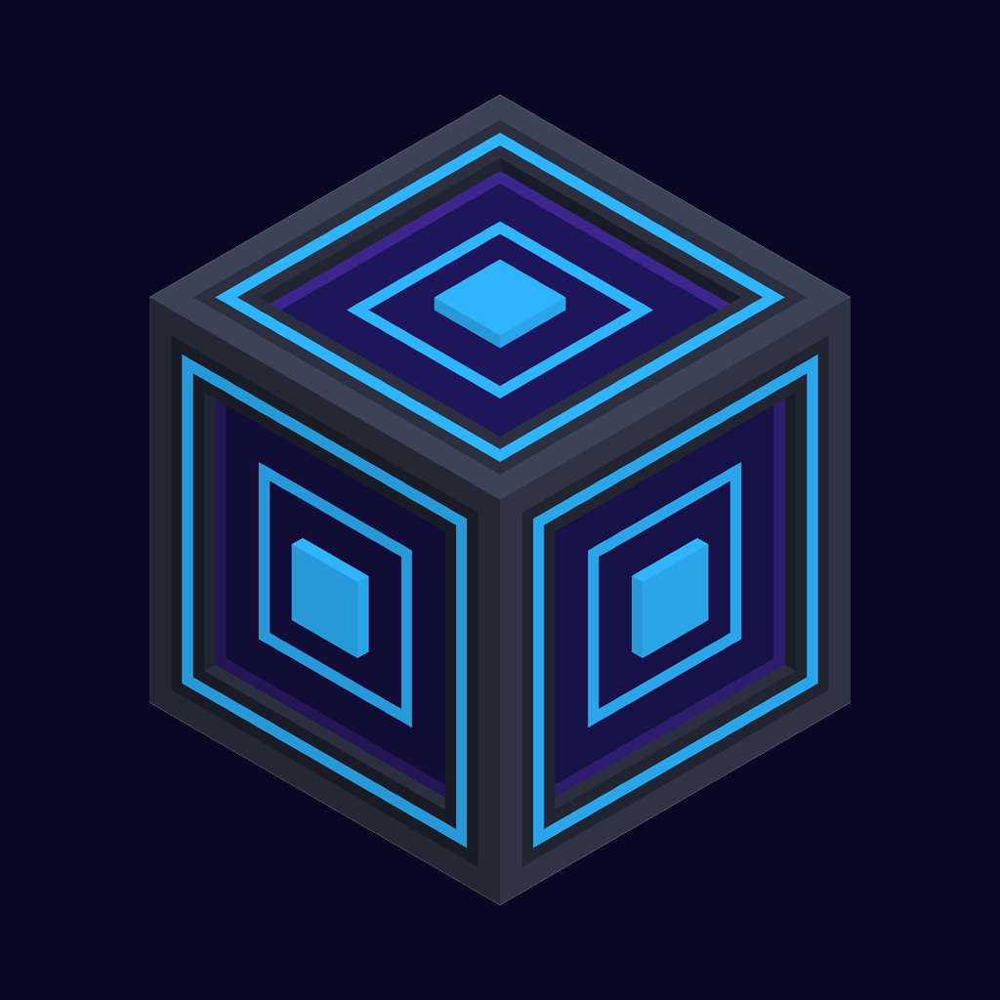

# Pushor

**Engine id:** `lithokraft:pushor`  
**Spelling:** Pushor (never Pusher or Pistor).  
**Kind:** Full block, resin pushing face on the front.

*CloudAtlas. State shown: retracted, blue, powered, standard family view (not the resin-face camera, and not extended). Extension, spit, and retract motion are still open and are not implemented in this build.*

## What it does in this build

The front (local north) is the resin pushing face: it takes no Trace and reads no power. The back, east, west, top, and bottom accept Trace and read soft and hard power.

While the Pushor is hard powered, it soft-powers adjacent Pushors on all six world axes (quasi-connectivity). A Pushor powered only that way does not pass the effect on.

The stated push limit is 32 blocks. The constant is recorded in the code (`kPushorPushLimit = 32`) and is not applied yet, because nothing is pushed.

This build only senses power. State "on" means powered (it lights the power tint). Aux bit 0 means hard powered this tick (a component output driving straight into a Trace face). The block emits no signal.

## Open and unimplemented

- **Extension distance is OPEN.** There is no extend, no spit, and no retract. The one-tick spit versus push-and-retract rule needs a distance, so it is not wired either. The still on this sheet is the retracted model, which is the rest pose, not a finished motion.
- **Immovable blocks**, and how a resin-bonded assembly counts against the 32, are OPEN. Resin is not in as a bonding mechanic; see [Resin](resin.md).
