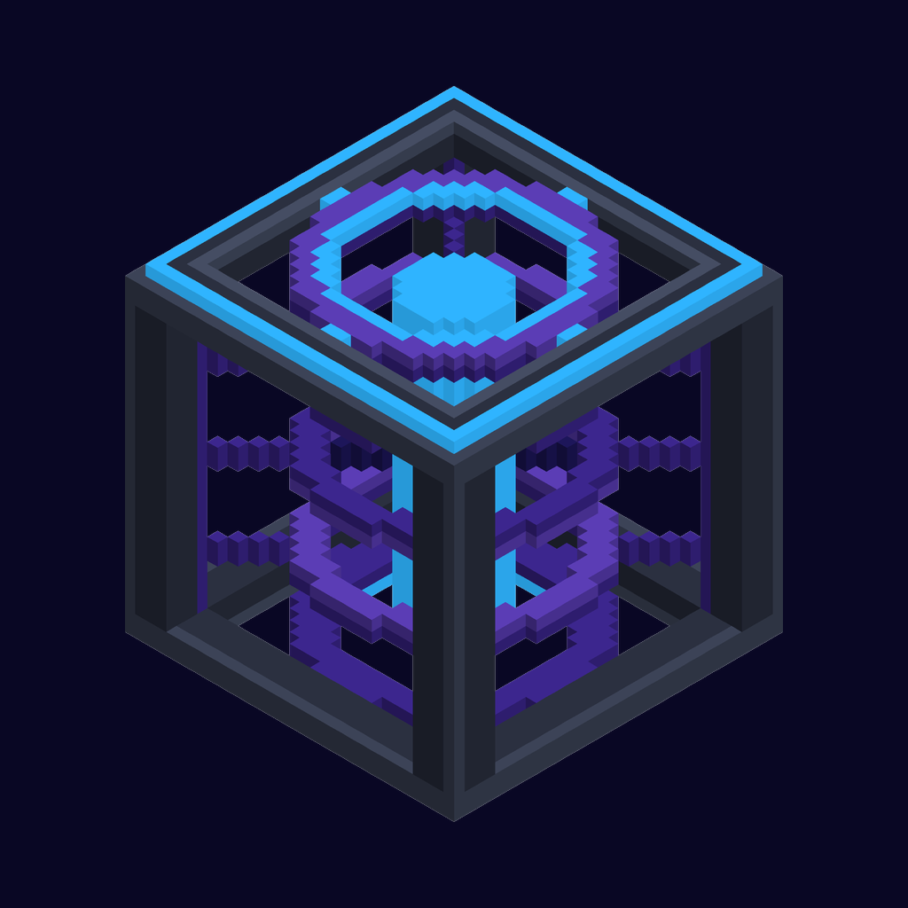

# Via

**Engine ids:** `lithokraft:red_via`, `lithokraft:blue_via` (vertical, the placeable items); side-lying variants `red_via_x`, `red_via_z`, `blue_via_x`, `blue_via_z` (palette-hidden; auto-built at junctions).  
**Spelling:** Via. The floor label in the Component Test world is RED VIA / BLUE VIA.  
**Kind:** Hollow, semi-solid, insulated tube. Sim role is wire, not a ticking component.

*CloudAtlas. State shown: Via B lattice cage, straight single, blue (channel 2), strength 64. Not a slim tube, and not an elbow.*

## What it does

A Via is an insulated vertical (or side-lying) tube that Trace runs through. Red and blue tubes can sit side by side. Same-colour vias stack into a run.

Vias are lossless: when a signal enters or leaves a via, strength does not drop. The BFS rule is `next strength = s` if either end is a via, otherwise `s - 1`. Pulsor pulses that travel through vias stay on the same-hop frontier, so a via cell does not consume a step of the 64-block pulse reach.

Link rules:

- Vertical: same colour, at least one vertical via, and no side via on that step. Straight up or down.
- Horizontal, same y: at least one side-lying via whose axis matches the step. The other end may be a matching side via, a vertical via (a pipe elbow), or flat Trace.

Elbows are a look and a link, not a separate placeable. The Component Test world does not include an elbow pad, because elbows are auto-built at a junction. Side-lying variants are hidden from the creative palette; they drop as their base colour (red or blue Via).

The approved art for this sheet is the lattice-cage Via B, straight. A broken-via stub exists as a ruins block and is a different id.

## Open and unimplemented

The slim-tube via look is not the approved still used here and is not this reference's Via. Pattern-ROM and other idea-list blocks from earlier design notes are not Vias and are not claimed as shipped.
