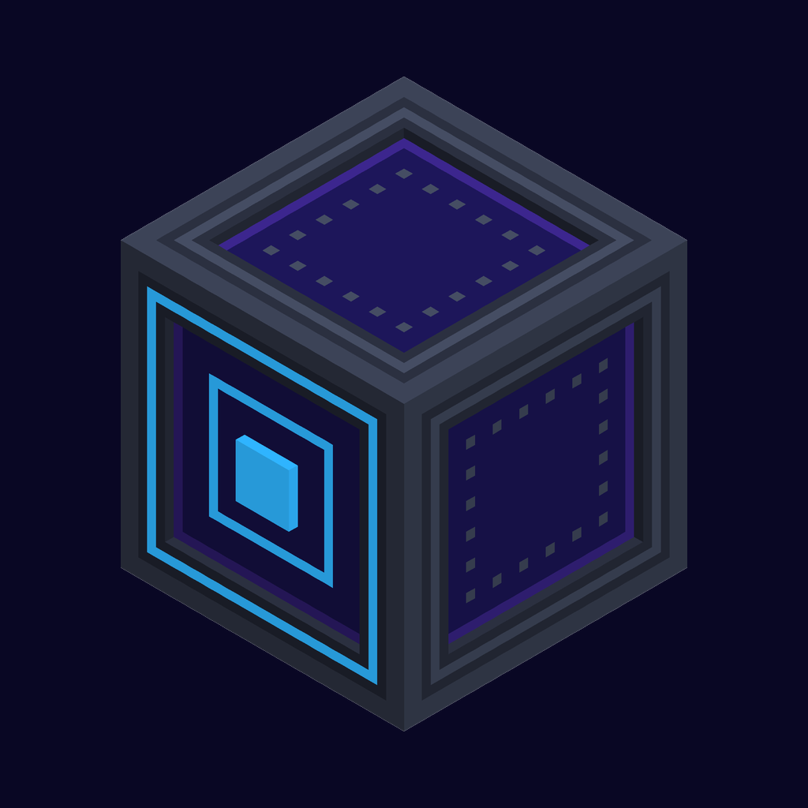

# Watchor

**Engine id:** `lithokraft:watchor`  
**Spelling:** Watchor (never Watcher).  
**Kind:** Full block, eye cube.

*CloudAtlas. State shown: Watchor B, standard family iso (front away from the camera), blue, firing. This is not the eye-view camera.*

## What it does

The front (local north) is the eye. It watches the block directly ahead. The side faces have no function: no input and no output.

On any change in the watched cell, the Watchor emits full strength 64 out the back, for exactly one tick. It refires at most every two ticks (fire one tick, rest one tick). A change that arrives on the rest tick produces no pulse.

The watched cell is read in the component pass before any component applies, in a sorted, order-free snapshot, so a Watchor sees a change one tick after it happens. Chained Watchors therefore shift phase by one tick.

## Open and unimplemented

These edge cases are not decided, and they do not yet have a behaviour:

- A block appearing where air was.
- A block being removed.
- A resin assembly sweeping through the watched cell. (Resin bonding and Pushor motion are themselves not implemented; see [Resin](resin.md) and [Pushor](pushor.md).)

Until those are decided, the Watchor reports what the snapshot of the cell ahead already contains, and it does not invent a rule for appear, remove, or sweep.
