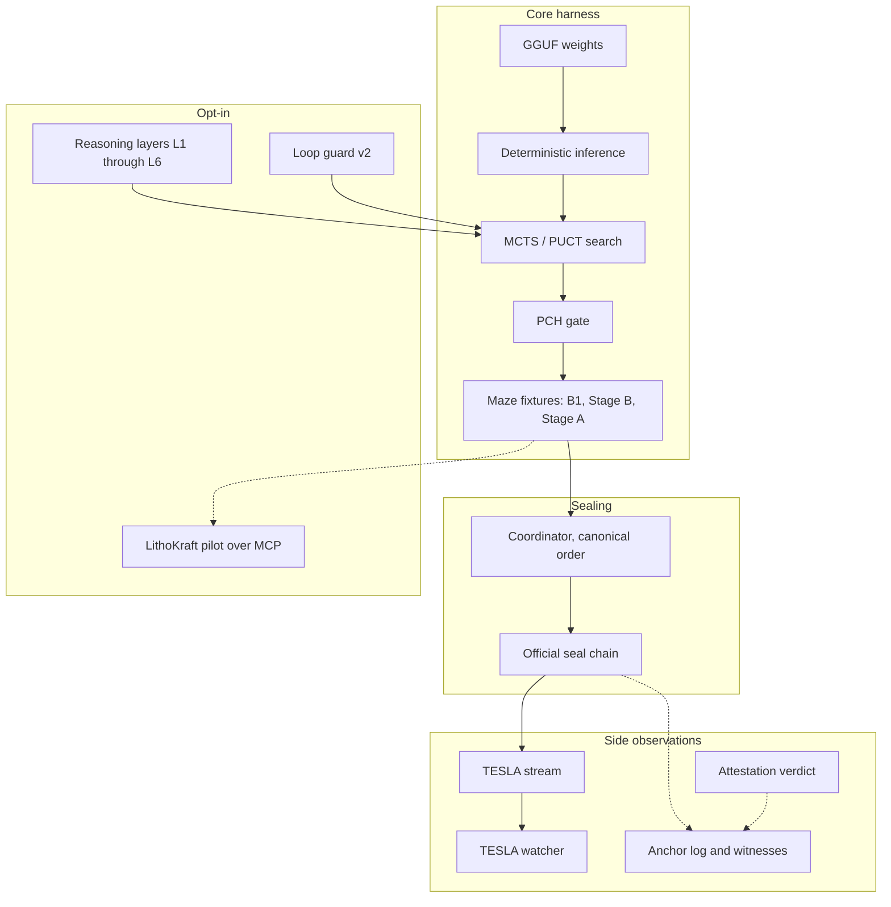
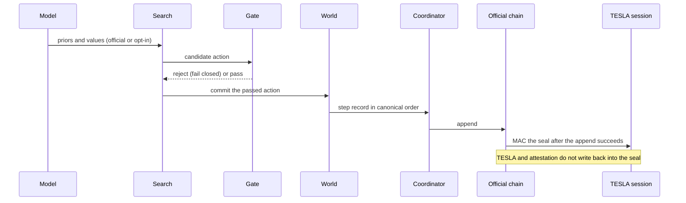

# Architecture

PCHIE is a control harness around a language model, not a model with a log bolted on afterwards. The core library (`pchie_core`) loads GGUF weights, runs deterministic CPU kernels (and, when built, CUDA kernels), keeps key-value caches in pools, searches with MCTS and PUCT, and commits actions into maze fixtures through a personal-control (PCH) stack. Official runners use that path with the reasoning-layer flags off. Opt-in layers, a loop guard, a TESLA side stream, an attestation verdict, and a transparency-anchoring log sit beside that path. They do not replace it.

More views (component, deployment, a detailed decision step, key interfaces, and the run lifecycle) are on the [Diagrams](diagrams.md) page.

## Components

- **Inference and search.** The core loads a GGUF model (Little Nemo in the recorded runs), runs kernels with precise floating-point settings, and searches with PUCT. The GGUF reader and the model loader treat the file as untrusted and refuse a malformed one at load time. Ties break by lowest token id. Official search can mix in a distance oracle; the opt-in model-driven path does not, and is described in [Reasoning layers](reasoning-layers.md).
- **Personal-control gate.** Legal-move masking and the PCH gate stay in force on every path. A gate-rejected edge is not a candidate. Fail closed is the rule throughout: a bad or unknown input is refused, not papered over.
- **Maze fixtures.** B1 is a 16x16 headless grid (official search uses seed 1). Stage B is a puzzle-maze with doors that ask a Dividor question. Stage A appears as a larger pit-maze fixture and as an in-engine LithoKraft testbed. Drivers include `HeadlessMaze` (B1 and Stage A) and `StageBDoorMaze`.
- **Coordinator and seal chain.** Only the coordinator appends, in canonical step order, never in worker completion order. The default chain is SHA-256 generation `pchie.seal.v1-sha256`. A ratcheted generation exists and is off unless a caller asks for it. See [Seal chains](seal-chains.md).
- **Join dispatcher.** Worker threads evaluate search work. They never append to the official chain. Results are folded in work-id order. Duplicate or missing ids fail closed.
- **Reasoning layers and loop guard.** Six opt-in layers live under `include/pchie/rl/`. Official runners leave every layer flag off. Loop guard v2 is on by default in the maze drivers and can be turned off for comparison. See [Reasoning layers](reasoning-layers.md).
- **TESLA stream and watcher.** After an official append succeeds, a side session can MAC the sealed step and later disclose interval keys. A separate program, `pchie_tesla_watcher`, verifies the stream. See [TESLA stream authentication](tesla-stream-authentication.md).
- **Attestation appraisal.** A verdict of Attested, Unattested, or Rejected is recorded beside the run label. In-process appraisal never talks to the TPM. A real measure, extend, and quote is a separate bench check against PCR 23. See [Hardware attestation](hardware-attestation.md).
- **Transparency anchoring.** After a run finishes, `pchie_anchor` can emit a record into a local Merkle log, produce a fingerprint, and collect witness cosignatures. The log never feeds a run. See [Transparency anchoring](transparency-anchoring.md).
- **LithoKraft pilot.** `pchie_lk_pilot` can decide a maze in the harness and then actuate the committed walk in a running LithoKraft game over the engine's MCP server. This repository does not include or compile the game. See [LithoKraft and LithoLattice](lithokraft-integration.md).

## Data flow of a committed step

The official append happens first and is authoritative. If TESLA is on, the side session MACs that seal and a payload hash after the append has already succeeded. If a TESLA emit fails, the session stops and records an error; it does not unwind the official append and it does not throw into the maze. Stage B has no official chain; TESLA is taken over the committed actions after the walk, still as a side stream.

At the end of a run, an operator can emit an anchor record from the finished artifacts (run id, label, weights hash, chain file, expected head). Anchoring reads those artifacts. It does not sit in the decide loop.

## What does not flow backward

Several parts of the tree are observers by construction:

- Anchor records, signed tree heads, and witness packets do not feed a run.
- TESLA packets and attestation verdicts are not written back into a seal, a world hash, an actions list, or a side log that the decide path reads.
- Query-before-plan memory hits are proposals only. They never commit an action directly, and the store is not written while a run is live.
- The LithoKraft pilot actuates a walk that the harness has already decided. It refuses to move if the world it reads back does not match the grid it decided on.

## Where the code lives

| Path | Role |
|---|---|
| `include/`, `src/` | Core harness: loading, kernels, KV pools, search, PCH stack, maze fixtures, hash chains. |
| `include/pchie/rl/`, `src/rl/` | Reasoning-layer headers and sources, including the loop guard. |
| `tests/`, `tests/rl/` | Gate and regression tests, including pins for official hashes. |
| `anchoring/` | Anchor tool, Merkle log, witness policies, and their tests. |
| `tools/` | TESLA watcher, LithoKraft pilot, other small utilities. |
| `experiments/` | Launchers that produced the recorded measurements. |
| `docs/guide/` | This guide. |

CUDA is an optional backend (`PCHIE_CUDA`). The reasoning layer is part of the root CMake build. Model weights stay outside the repository.
