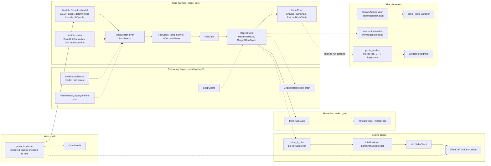
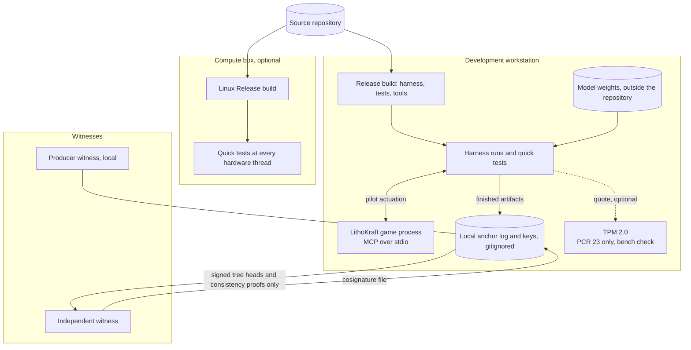
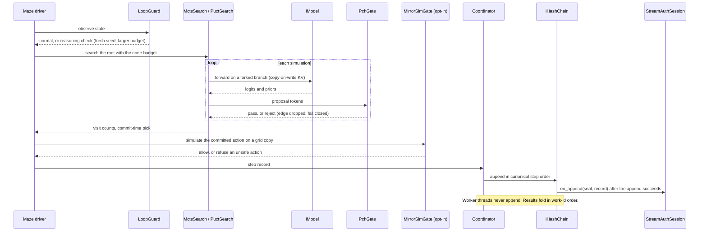
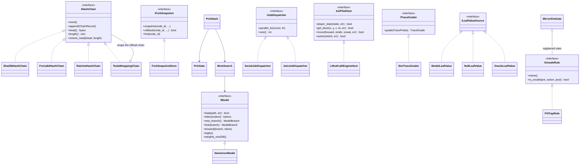

# Diagrams

These diagrams describe how the pieces in this tree fit together. They are drawn from the code under `include/`, `src/`, `tools/`, `vision/`, and `anchoring/`, and use the class and tool names found there. The [Architecture](architecture.md) page has the overview flowchart and the committed-step sequence; this page adds a component view, a deployment view, a detailed decision step, the key interfaces, and the run lifecycle.

## Components

Solid arrows are the decide path. Dotted arrows are opt-in layers or observers that read a run without feeding it.

## Deployment

The anchor tool never opens a network connection. Packets and cosignatures move as files, and a witness only ever sees signed tree heads and consistency proofs, never records, chains, run ids, or weights. Thread count does not change any hash, so a run on either machine must reproduce the same Official pins.

## One decision step

## Key interfaces

`TeslaWrappingChain` forwards every append to the official chain first and only then MACs the seal, so the official head is identical with TESLA on or off.

## Run lifecycle

```mermaid
stateDiagram-v2
  [*] --> Genesis: load weights, set seed and flags
  Genesis --> Deciding: chain at genesis head
  Deciding --> Sealed: step appended to the chain
  Sealed --> Deciding: next step
  Deciding --> Forked: DualPool rollback (fork)
  Forked --> NewEpoch: restore_head, then re-root
  Deciding --> Frozen: watchdog freeze
  Frozen --> NewEpoch: resume from the last good head
  NewEpoch --> Deciding: ratcheted chains open a new epoch; v1 chains continue unchanged
  Deciding --> Finished: exit reached, budget spent, or stall
  Finished --> Closed: TESLA keys disclosed, attestation verdict recorded
  Closed --> Anchored: optional pchie_anchor emit (side log)
  Anchored --> Cosigned: witness cosignatures taken in
  Closed --> [*]
  Cosigned --> [*]
```

An epoch re-root names the event (fork or resume) and where it happened, so a forked or resumed run never verifies as one straight line. Anchoring happens after a run is finished and never changes its label.
