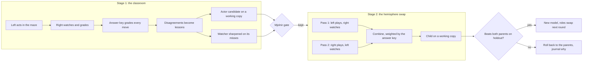

# The left and right hemispheres on Bolt E4B

This page covers the PCHIE side of the left and right hemispheres. PCHIE is the world and the answer key; Mjolnir is the pilot that keeps or rolls back every change and journals why. The design, both stages and the guardrails are described in full on Mjolnir's hemispheres page (`docs/hemispheres.md` in the Mjolnir tree). This page describes what PCHIE adds so a real model can take part, and what the first real run on a 4 GB laptop GPU showed.

The idea, the two-stage pipeline and the names are **Jaydee Wetwork**'s (Wet Wafer Works). MIT license.

## Design principles

1. The answer key is always the final judge. A watcher's verdict is advice; the key decides what counts.
2. Model originals are read-only. Every edit is on a working copy, and every working copy is identified by the SHA-256 of its weights so it can be rolled back.
3. Nothing is kept unless it does better on held-out worlds than what it replaces.
4. Every lesson and every decision goes into Mjolnir's journal.
5. The interface must not assume one model's layout. A hemisphere is anything that gives a distribution over the legal moves of a world state.

## The two stages



```mermaid
sequenceDiagram
    participant P as PCHIE (world, answer key, model)
    participant M as Mjolnir (mj_hemi gate)
    participant J as Journal (hemispheres.mjl)
    P->>P: play guided maze states, grade every move with the oracle
    P->>P: write the lesson set and one holdout set per model (MJHEMI2, sealed with SHA-256, naming each model's SHA-256)
    P->>M: gate --kind actor|watcher|swap, the sets, parent and candidate SHA (no scores), started without a shell
    M->>M: check seals, bounds and that the sets bind to the models; work out every score; apply the rule
    M->>J: append a hash-chained record
    M-->>P: keep (exit 0) or roll back (exit 3)
```

## What PCHIE adds

| Piece | Files | What it does |
|---|---|---|
| Sample sets | `include/pchie/hemispheres/SampleSet.h`, `src/hemispheres/SampleSet.cpp` | Writes and reads MJHEMI2, byte for byte the same format as Mjolnir. Each set names the full SHA-256 of the model that acted and the one that watched, and whether it is a lesson or holdout evidence. Every field is bounds-checked; reserved bytes must be zero; the SHA-256 seal is checked before anything is trusted. Logits become 16-bit probabilities over the legal moves only, and non-finite logits are refused. |
| Hemisphere interface | `include/pchie/hemispheres/Hemisphere.h`, `src/hemispheres/Hemisphere.cpp` | `IHemisphere` (state in, move distribution out) and `IWeightOverlayTarget`, which names tensors by their Hugging Face names rather than by one model's layer layout, so a mixture-of-experts or Mamba model can plug in with its own target. `Gemma4OverlayTarget` is the first one, for Bolt E4B. |
| Grid maze world | `include/pchie/hemispheres/GridMazeWorld.h` | Six moves (north, south, east, west, pick up, use), a key, a door and an exit. The answer key clears a move if it shortens the maze oracle's shortest path or reaches the exit. States are described to the model in short plain text. |
| Weight overlay | `Gemma4Model::set_linear`, `Gemma4Model::linear` | Swaps one linear layer's weights for a same-shaped buffer the caller owns. Checks the shape, the type and the alignment. The file on disk is never touched. |
| Residual capture | `Gemma4Model::set_capture` | Copies the residual entering one layer during a single-token step, so the layers after it can be rerun with different weights without rerunning the trunk. |
| Starting Mjolnir | `include/pchie/hemispheres/Spawn.h`, `src/hemispheres/Spawn.cpp` | Starts `mj_hemi` by its full path with an argument list, never through a shell: `CreateProcessW` on Windows, `posix_spawn` elsewhere. Also checks every path given on the command line. |
| Ternary folder | `include/pchie/hemispheres/TernaryFolder.h`, `src/hemispheres/TernaryFolder.cpp` | Reads the converter's `manifest.tsv` by column name, and reads each ternary file whole and checks it against the manifest's SHA-256 before using a byte of it. A PTN1 file's own checksum only catches accidents. |
| The tool | `tools/pchie_hemispheres.cpp` | `probe` and `run`, described below. |
| Tests and fuzzing | `tests/pchie_hemispheres_test.cpp`, `fuzz/pchie_hemi_set_fuzz.cpp`, `fuzz/pchie_ternary_manifest_fuzz.cpp` | ctest `pchie_hemispheres`, `pchie_hemi_set_fuzz_smoke` and `pchie_ternary_manifest_fuzz_smoke`. |

## Why only the tail is edited

Layers 24 to 41 of Bolt E4B reuse earlier layers' keys and values. For a fixed prompt, everything from a shared-KV layer onward is a pure function of that layer's input, the per-layer embedding and the read-only cache. So the tool runs the trunk once per state on the GPU, captures the residual entering `--tail-from` (default 38), and then reruns only layers 38 to 41 and the six move rows of the output head on the CPU, once per candidate. The probe checks that this tail gives the same logits as a full forward pass, to the bit.

The only weight edit in this first real run is a one-parameter line between two versions of the tail: the ternary conversion (t = 0) and the BF16 expansion of the Q4 weights (t = 8/8), with seven points between them. The left starts as the ternary tail and the right as the Q4 tail; both are the same network at two precisions. Every point on the line is identified by the SHA-256 of its tail weights. This is a deliberately small edit space, so the pilot, the gate and the journal can be proved on a real model; it is not yet a learned update.

## Running it

```
pchie_hemispheres probe --gguf Nemotron-3.5-Bolt-E4B-Q4_K_M.gguf --ternary <ternary output folder>
pchie_hemispheres run --gguf Nemotron-3.5-Bolt-E4B-Q4_K_M.gguf --ternary <ternary output folder> \
    --data <run folder> --mjolnir <path to mj_hemi> [--save-model]
```

`run` defaults: 6 lesson mazes, 10 holdout mazes, 7x7, seed 1, 2 classroom rounds, 2 swap rounds, a step cap of 3 grid points per round. Every decision is made by `mj_hemi gate`, which works out the scores from the run's `classroom-N-lesson.mjhemi`, `swap-N-pass1/2.mjhemi` and `holdout-*.mjhemi` sets and appends to `<run folder>/hemispheres.mjl`. `--save-model` writes the new tail (`tail.bf16`, `manifest.tsv`, `RECIPE.txt`) to `<run folder>/new-model`; the GGUF and the ternary folder are only read.

## Guardrails

- The GGUF, the ternary folder and the original safetensors are opened read-only.
- No mutexes: work is split by phase boundaries.
- Every parser is bounds-checked and has a fuzz target.
- Hashes are provisional. Nothing here is promoted to an official record.
- The tool checks that the GPU has not taken any tail layer before it starts.
- Mjolnir is never told a score. For every decision the tool writes a lesson set and one holdout set per model, each naming the SHA-256 of the tail that acted and the one that watched, and Mjolnir works the scores out itself.
- No shell. `mj_hemi` is started with an argument list, and folders are made with the C++ filesystem library. Paths with control characters or characters Windows does not allow in paths (`" < > | ? *`) are refused before anything is loaded. The test starts itself as a child with arguments such as `& echo x > file`, `$(...)`, `%PATH%` and quotes, and checks they arrive untouched and nothing ran.
- Every ternary file is checked against the manifest's SHA-256; the manifest's own SHA-256 goes into the new model's recipe.

## Results on Bolt E4B (19 November 2026)

These results are from the first run, before the review fixes, when the tool still passed its own scores to Mjolnir. The run is being repeated with the reviewed gate.

Bolt E4B Q4_K_M on an RTX 3050 Ti Laptop (4 GB), i5-12450H. GPU layers 0 to 37, tail layers 38 to 41 on the CPU. All hashes are provisional.

**Probe.**

- cosine(ternary, Q4) on the 28 tail tensors ranges from 0.860 to 0.901.
- The tail rerun matches the full forward pass on 24 of 24 logits, to the bit.
- The trunk runs at about 9 to 10 tokens a second and the tail takes 28 to 83 ms per candidate.

**Run** (`run --save-model`, defaults):

- 75 lesson states from 6 mazes and 117 holdout states from 10 mazes, all 7x7.
- 4,830 trunk tokens and 1,728 tail evaluations took 711 s of model work.

Holdout play along the line (basis points of moves the answer key cleared):

| t | 0 (ternary) | 1/8 | 2/8 | 3/8 | 4/8 | 5/8 | 6/8 | 7/8 | 8/8 (Q4) |
|---|---|---|---|---|---|---|---|---|---|
| bp | 9230 | 9914 | 9914 | 9914 | 9914 | 9914 | 9914 | 10000 | 9230 |

**Stage 1, the classroom.** The left (ternary) acts and the right (Q4) watches.

| Round | Lesson | Watcher | Actor (holdout bp) | Watcher (judgments, own play) | Mjolnir |
|---|---|---|---|---|---|
| 1 | 75 steps, 69 cleared | agreed-right 69, shared mistakes 5, objected-right 1 | t=0 to t=3/8: 9230 to 9914 | t=8/8 to t=5/8: 9230 to 9914, 9230 to 9914 | actor keep, watcher keep |
| 2 | 75 steps, 75 cleared | agreed-right 75 | t=3/8 to t=4/8: 9914 to 9914 | t=5/8 to t=3/8: no change | both roll back; the classroom stops |

**Stage 2, the hemisphere swap.** Parents left t=3/8 and right t=5/8, both 9914. Both passes cleared 75 of 75. The child t=4/8 scored 9914, which does not beat both parents, so Mjolnir rolled back to the parents and journaled why.

**New model.** t=3/8, holdout 9914 bp. Tail SHA-256 `646e25c4db58a0cc1892cc1a54903623a0c4bfebca75bb91e3ce2afc9a85f1eb`, saved as `new-model/tail.bf16` (744 MB) with its manifest and recipe. The journal has 5 records and verifies with `mj_ledger_verify`. Each of its sample sets reads back with `mj_hemi show` and `mj_hemi replay`.

**What this shows and what it does not.**

- The whole path works on a real model: world, answer key, sample sets, the classroom, the swap, the gate, the journal and the saved new model.
- Mixing the two precisions lifts both of them, from 9230 to 9914. One point on the line (t=7/8) reaches 10000, but the step cap of 3 grid points per round and the second round's lack of disagreements (no lesson left to learn) kept the classroom from walking there.
- The 7x7 holdout is close to saturated. A bigger or harder world is needed to separate the candidates.

## What is missing

- The real edit is a one-parameter blend between two existing tails, not a learned update of individual weights.
- Little Super Nemo (from Nemotron 3.5 Super VL) is not converted to ternary yet, and the PCHIE runtime has no mixture-of-experts or Mamba-2 layers, so it cannot be a hemisphere yet. The overlay interface is keyed by tensor names so it can be added without changing the pilot.
- The tail runs on the CPU. On a 4 GB GPU, the trunk fills the card.
- Mjolnir checks that the answer key's grades are consistent across every set, but it does not regrade the moves itself: the answer key is the final judge by design, and it lives in PCHIE's deterministic, tested world code.
- The 7x7 holdout is close to saturated, so most points on the line score the same. A bigger or harder world is needed to separate them.

## Background and credits

- The idea, the two-stage pipeline and the names: **Jaydee Wetwork**, Wet Wafer Works.
- Background: published research on two networks learning from each other (deep mutual learning), on knowledge distillation and self-distillation, and on teacher-student and actor-critic training. This is a clean-room build from the ideas in those papers. No code from them was used.
- License: MIT.
